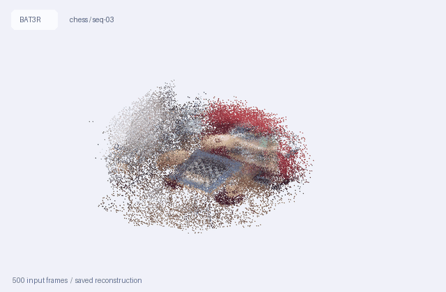
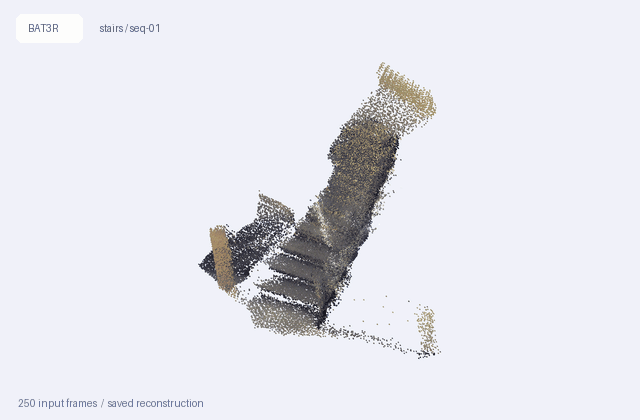

# BAT3R: Robust Online 3D Reconstruction with Bayesian Adaptive State Updates

**Official implementation · Accepted at NeurIPS 2026 (Poster)**

[](https://llj110.github.io/bat3r/)
[](https://openreview.net/forum?id=MP758ZsHYv)
[](https://neurips.cc/virtual/2026/poster/153286)
[](https://github.com/llj110/BAT3R/actions/workflows/bat3r-check.yml)

[Lijian Li](https://openreview.net/profile?id=~Lijian_Li1),
[Yuanpeng He](https://openreview.net/profile?id=~Yuanpeng_He1),
[Yudian Zheng](https://openreview.net/profile?id=~Yudian_Zheng1),
[Chung-ju Huang](https://openreview.net/profile?id=~Chung-ju_Huang1),
[Linyu Li](https://openreview.net/profile?id=~Linyu_Li1),
[Dongming Jin](https://openreview.net/profile?id=~Dongming_Jin1),
[Wenpin Jiao](https://openreview.net/profile?id=~Wenpin_Jiao1),
[Zhi Jin](https://openreview.net/profile?id=~Zhi_Jin1),
[Chi-Man Pun](https://openreview.net/profile?id=~Chi-Man_Pun1)

BAT3R adapts recurrent scene states during online 3D reconstruction. State
Innovation Gating (SIG) anchors updates to the initial state, while Bayesian-guided
Adaptive State Updating (BASU) combines historical uncertainty, observation
confidence, and spatial relevance. The implementation extends
[TTT3R](https://github.com/Inception3D/TTT3R) and
[CUT3R](https://github.com/CUT3R/CUT3R).

**[Project homepage](https://llj110.github.io/bat3r/) · [Paper](https://openreview.net/forum?id=MP758ZsHYv) · [NeurIPS 2026 Poster](https://neurips.cc/virtual/2026/poster/153286) · [Interactive 3D demo](https://llj110.github.io/bat3r/#demo)**

## 3D showcase

Two saved BAT3R reconstructions: **Chess (500 input frames)** and
**Stairs (250 input frames)**. The previews
rotate automatically in a continuous loop. **Click either scene to open its
interactive 3D view**, with automatic rotation enabled; drag to orbit and scroll
to zoom.

| Chess · 7-Scenes | Stairs · 7-Scenes |
| :---: | :---: |
| [](https://llj110.github.io/bat3r/?scene=7s-chess_seq-03&compare=none&rotate=1#demo) | [](https://llj110.github.io/bat3r/?scene=7s-stairs_seq-01&compare=none&rotate=1#demo) |
| [Explore chess in 3D ↗](https://llj110.github.io/bat3r/?scene=7s-chess_seq-03&compare=none&rotate=1#demo) | [Explore stairs in 3D ↗](https://llj110.github.io/bat3r/?scene=7s-stairs_seq-01&compare=none&rotate=1#demo) |

These qualitative previews use the same saved, sampled point clouds as the
project website, preserving their positions and original RGB. GitHub Markdown
displays animated previews; interactive WebGL runs on the linked project page.
See [preview sources and checksums](media/showcase/bat3r_showcase.json) and
[the preview renderer](tools/bat3r_render_showcase.py).

## Quick links

| Resource | Link |
| --- | --- |
| Project website | [Method overview and results](https://llj110.github.io/bat3r/) |
| Interactive demo | [Explore 27 saved reconstruction scenes](https://llj110.github.io/bat3r/#demo) |
| Paper and reviews | [OpenReview](https://openreview.net/forum?id=MP758ZsHYv) |
| Conference record | [NeurIPS 2026 poster](https://neurips.cc/virtual/2026/poster/153286) |
| Code | [BAT3R repository](https://github.com/llj110/BAT3R) · [Core implementation](src/bat3r/) |
| Starting checkpoint | [CUT3R 512 DPT download](https://drive.google.com/file/d/1Asz-ZB3FfpzZYwunhQvNPZEUA8XUNAYD/view) · [Upstream instructions](https://github.com/CUT3R/CUT3R#download-checkpoints) |
| Example inputs | [Westlake video](examples/westlake.mp4) · [Taylor video](examples/taylor.mp4) |
| Benchmarks and data | [Dataset sources and preparation](docs/BAT3R_DATASETS.md) · [Evaluation guide](eval/README.md) |
| Implementation guide | [Code map](docs/BAT3R_CODEMAP.md) · [Release checklist](docs/BAT3R_RELEASE_CHECKLIST.md) |
| Validation | [Source-check workflow](https://github.com/llj110/BAT3R/actions/workflows/bat3r-check.yml) · [CPU tests](tests/test_bat3r_release.py) |
| Citation | [BibTeX](#citation) · [CITATION.cff](CITATION.cff) |
| Questions and bugs | [GitHub Issues](https://github.com/llj110/BAT3R/issues) |

The public project website includes an interactive explorer of saved server
reconstructions, paired geometry comparisons, input-camera paths, and evaluation
snapshots. The viewer displays sampled saved results; it does not run new GPU
inference. The paper is linked through OpenReview; an arXiv identifier has not
yet been confirmed. The checkpoint above is the
upstream CUT3R starting model; see [checkpoint provenance](#checkpoint) before
using it to reproduce paper results.

## Contents

- [3D showcase](#3d-showcase)
- [BAT3R implementation](#bat3r-implementation)
- [Installation](#installation)
- [Checkpoint](#checkpoint)
- [Inference](#inference)
- [Static reconstruction renders](#static-reconstruction-renders)
- [Datasets](#datasets)
- [Evaluation](#evaluation)
- [Validation](#validation)
- [Citation](#citation)
- [Acknowledgements and license notices](#acknowledgements-and-license-notices)
- [Support and release status](#support-and-release-status)

## BAT3R implementation

```text
BAT3R/
├── bat3r_demo.py                 # inference and PLY export
├── bat3r_reconstruct.py          # reconstruction and PNG rendering
├── bat3r_eval.py                 # common benchmark launcher
├── bat3r_run.sh                  # portable demo launcher
├── src/bat3r/
│   ├── bat3r_model.py            # recurrent reconstruction + global/pose gates
│   ├── bat3r_update.py           # Bayesian fusion + adaptive process noise
│   └── bat3r_inference.py        # sequence inference
├── src/dust3r/                   # inherited utilities + compatibility imports
├── src/croco/                    # inherited encoder/decoder components
├── eval/                        # benchmark implementations
└── tests/                       # CPU regression checks
```

| Component | Source |
| --- | --- |
| Reconstruction model and SIG | [bat3r_model.py](src/bat3r/bat3r_model.py) |
| Bayesian state fusion / BASU | [bat3r_update.py](src/bat3r/bat3r_update.py) |
| Recurrent inference | [bat3r_inference.py](src/bat3r/bat3r_inference.py) |
| Video demo and PLY export | [bat3r_demo.py](bat3r_demo.py) |
| PNG rendering | [bat3r_reconstruct.py](bat3r_reconstruct.py) |
| Benchmark launcher | [bat3r_eval.py](bat3r_eval.py) |

See [the code map](docs/BAT3R_CODEMAP.md) for component locations and
[the release checklist](docs/BAT3R_RELEASE_CHECKLIST.md) for remaining artifacts.

## Installation

Run commands from the repository root, using Python 3.11 and a CUDA-compatible
PyTorch installation:

```bash
git clone https://github.com/llj110/BAT3R.git
cd BAT3R
conda create -n bat3r python=3.11 cmake=3.14.0
conda activate bat3r
conda install pytorch torchvision pytorch-cuda=12.1 -c pytorch -c nvidia
pip install -r requirements.txt
conda install "llvm-openmp<16"
cd src/croco/models/curope
python setup.py build_ext --inplace
cd ../../../..
```

Dependencies are listed in [requirements.txt](requirements.txt). For installation
reference, see [PyTorch](https://pytorch.org/get-started/locally/),
[Conda](https://docs.conda.io/projects/conda/en/stable/user-guide/install/index.html),
[Open3D](https://www.open3d.org/docs/release/getting_started.html), and
[the upstream CUDA/RoPE instructions](https://github.com/CUT3R/CUT3R#installation).
Dependencies are not fully version-locked; see the release checklist.

## Checkpoint

Download [`cut3r_512_dpt_4_64.pth`](https://drive.google.com/file/d/1Asz-ZB3FfpzZYwunhQvNPZEUA8XUNAYD/view)
using the
[official CUT3R checkpoint instructions](https://github.com/CUT3R/CUT3R#download-checkpoints)
and place it under `src/`, or pass an external path with `--model_path` for
inference and `--weights` for evaluation. This is an upstream starting checkpoint.
Exact BAT3R experiment checkpoint provenance is still needed for reproducing
reported results; see the release checklist.

## Inference

```bash
CUDA_VISIBLE_DEVICES=0 python bat3r_demo.py \
    --model_path src/cut3r_512_dpt_4_64.pth \
    --seq_path examples/westlake.mp4 \
    --size 512 --output_dir tmp/bat3r \
    --model_update_type bat3r
```

The demo writes per-frame artifacts and a merged `video_merged.ply` with camera
metadata. `--seq_path` accepts a video or image directory.

| Argument | Default | Purpose |
| --- | --- | --- |
| `--model_path` | `src/cut3r_512_dpt_4_64.pth` | Checkpoint path |
| `--model_update_type` | `bat3r` | `bat3r`, legacy `ttt3r`, or reference `cut3r` |
| `--size` | `512` | Input resolution |
| `--frame_interval` | `1` | Frame sampling interval |
| `--reset_interval` | `1000000` | State reset interval |
| `--vis_threshold` | `1.5` | Point confidence threshold |

`bash bat3r_run.sh ...` forwards arguments to the demo. Set `PYTHON` to use
an existing Python environment. The old `demo.py` and `run.sh` names still work.

## Static reconstruction renders

```bash
python bat3r_reconstruct.py \
    --model_path src/cut3r_512_dpt_4_64.pth \
    --seq_path examples/westlake.mp4 \
    --model_update_type bat3r --output_dir tmp/bat3r_render \
    --render_dir tmp/bat3r_render/png --render_views 8 \
    --render_engine matplotlib
```

Use `filament` or `glfw` for Open3D rendering when available. See
`python bat3r_reconstruct.py --help` for rendering options.

## Datasets

| Benchmark | Original provider | BAT3R setup |
| --- | --- | --- |
| 7-Scenes | [Microsoft Research](https://www.microsoft.com/en-us/research/project/rgb-d-dataset-7-scenes/) | [Preparation](docs/BAT3R_DATASETS.md) · [Multi-view loader](eval/mv_recon/data.py) |
| TUM RGB-D | [Downloads](https://cvg.cit.tum.de/data/datasets/rgbd-dataset/download) | [Preprocessing](datasets_preprocess/long_prepare_tum.py) |
| ScanNet | [Official download instructions](https://github.com/ScanNet/ScanNet#scannet-data) | [Preprocessing](datasets_preprocess/long_prepare_scannet.py) |
| KITTI | [Odometry](https://www.cvlibs.net/datasets/kitti/eval_odometry.php) · [Depth](https://www.cvlibs.net/datasets/kitti/eval_depth.php?benchmark=depth_prediction) | [Preprocessing](datasets_preprocess/long_prepare_kitti.py) |
| Bonn RGB-D Dynamic | [Dataset](https://www.ipb.uni-bonn.de/data/rgbd-dynamic-dataset/) | [Preprocessing](datasets_preprocess/long_prepare_bonn.py) |
| Sintel | [MonST3R source and preparation links](https://github.com/Junyi42/monst3r/blob/main/data/evaluation_script.md#sintel) | [Depth metadata](eval/video_depth/metadata.py) |
| Neural RGB-D (`NRGBD`) | [Project](https://dazinovic.github.io/neural-rgbd-surface-reconstruction/) · [Dataset ZIP](https://kaldir.vc.in.tum.de/neural_rgbd/neural_rgbd_data.zip) | [Preparation](docs/BAT3R_DATASETS.md) · [Multi-view loader](eval/mv_recon/data.py) |

See [dataset resources](docs/BAT3R_DATASETS.md) for expected paths, projected
7-Scenes depth, and inherited preparation recipes. Prepared sequence lengths
and dataset keys are defined in the [pose metadata](eval/relpose/metadata.py)
and [depth metadata](eval/video_depth/metadata.py).

## Evaluation

```bash
python bat3r_eval.py --task relpose \
    --weights src/cut3r_512_dpt_4_64.pth \
    --eval_dataset tum_s1_90 --size 512
```

The launcher defaults to `--model_update_type bat3r` and stores outputs under
`eval_results/bat3r/<task>`. Use a separate `--output_dir` for every dataset,
configuration, and seed to preserve results. Add `--dry-run` to inspect the
forwarded arguments without model execution.

See [evaluation instructions](eval/README.md) for pose, depth, reconstruction,
data preparation, and benchmark-specific flags.

The historical `ttt3r` mode is an alias for modified BAT3R paths in this
repository. It is not an independent upstream TTT3R baseline. The `cut3r` mode
selects the existing reference update path in this modified model.

## Validation

```bash
python -m unittest discover -s tests -v
```

CPU tests check compatibility imports, state-dict loading, confidence layouts,
and launcher dispatch. Optional exact numerical parity uses an ignored copy of
the pre-migration Bayesian module at `tests/_baseline_bayesian_ttt.py`.
GitHub Actions checks Python syntax and portable launcher syntax without a GPU.

## Citation

If you use BAT3R in your research, please cite the
[NeurIPS 2026 paper](https://openreview.net/forum?id=MP758ZsHYv):

```bibtex
@inproceedings{li2026bat3r,
  title     = {BAT3R: Robust Online 3D Reconstruction with Bayesian Adaptive State Updates},
  author    = {Li, Lijian and He, Yuanpeng and Zheng, Yudian and Huang, Chung-ju and
               Li, Linyu and Jin, Dongming and Jiao, Wenpin and Jin, Zhi and Pun, Chi-Man},
  booktitle = {Advances in Neural Information Processing Systems},
  year      = {2026},
  url       = {https://openreview.net/forum?id=MP758ZsHYv}
}
```

Machine-readable metadata is provided in [CITATION.cff](CITATION.cff).

## Acknowledgements and license notices

Inherited components retain their original names and notices:
[TTT3R](https://github.com/Inception3D/TTT3R),
[CUT3R](https://github.com/CUT3R/CUT3R),
[DUSt3R](https://github.com/naver/dust3r),
[MonST3R](https://github.com/Junyi42/monst3r), and
[CroCo](https://github.com/naver/croco).

See [LICENSE](LICENSE) and the bundled third-party notices, including
[src/croco/LICENSE](src/croco/LICENSE). The root file preserves upstream CUT3R
CC BY-NC-SA 4.0 and TTT3R MIT notices; no Apache-2.0 project-wide grant is asserted.

## Support and release status

Report bugs or ask implementation questions through
[GitHub Issues](https://github.com/llj110/BAT3R/issues). Include the command,
checkpoint source, dataset variant, environment versions, and error output.

The [release checklist](docs/BAT3R_RELEASE_CHECKLIST.md) tracks the remaining
reproduction package, checkpoint checksums, environment lock, and benchmark
protocols. The [project website](https://llj110.github.io/bat3r/) and the
[3D showcase](#3d-showcase) are available; a confirmed arXiv URL remains pending.
Paper results are not claimed to have been rerun by the namespace migration checks.
